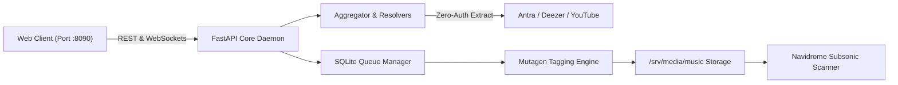

# PineMusic

```
+-----------------------------------------------------------------------------------------+
|                                    PINEMUSIC SERVER                                     |
|                                                                                         |
|   +-----------------------+     +------------------------+     +--------------------+   |
|   |  Multi-Source Ingest  | --> |     Queue Orchestrator | --> | Mutagen Tagger &   |   |
|   |  (Spotify/YT/Deezer)  |     |   (SQLite + WebSockets)|     | FLAC Vorbis Engine |   |
|   +-----------------------+     +------------------------+     +--------------------+   |
|                                                                          |              |
|                                                                          v              |
|                                                                +--------------------+   |
|                                                                | /srv/media/music   |   |
|                                                                | & .m3u8 Playlists  |   |
|                                                                +--------------------+   |
|                                                                          |              |
|                                                                          v              |
|                                                                +--------------------+   |
|                                                                | Navidrome Scanner  |   |
|                                                                | (/rest/startScan)  |   |
|                                                                +--------------------+   |
+-----------------------------------------------------------------------------------------+
```

PineMusic is a high-fidelity, zero-auth music requester, download queue orchestrator, and automated library manager for **Navidrome**. Inspired by the request tracking lifecycle of **Ombi** and the obsidian dark-glass audio experience of **Psysonic**.

---

## Key Features

- **Zero Sign-In / Zero Accounts Required**: No Spotify Premium, Apple Music, or Tidal credentials required. Resolves playlists and tracks via automated bitstream extraction and zero-auth APIs.
- **Universal Multi-Platform Resolution**:
  - Spotify playlists and albums (via Antra Lossless Engine)
  - YouTube Music & YouTube Playlists / Videos (via YT-DLP)
  - Deezer Hi-Fi 320k & FLAC (via Deezer API)
  - Apple Music, SoundCloud, and Bandcamp links
- **Audio Bitstream Selection**:
  - 24-bit Studio Master FLAC
  - 16-bit / 44.1kHz CD Quality FLAC
  - 320 kbps High-Bitrate MP3
  - 1080p MP4 Music Video
- **Interactive Live Queue**:
  - Real-time download progress, transfer speed, and ETA broadcasting via WebSockets.
  - Interactive reordering (Move Up / Move Down).
  - Cancel downloads and 1-click retry for failed items with alternate platform/quality fallback.
- **Direct Navidrome Integration**:
  - Automatically writes hierarchical files: `/srv/media/music/<Artist>/<Album>/<Track> - <Title>.<ext>`.
  - Generates relative M3U8 playlists in `/srv/media/music/Playlists/`.
  - Triggers Navidrome library scanner immediately upon completion (`/rest/startScan.view`).
  - Single-click "Delete from Device" with confirmation that unlinks physical files and removes them from Navidrome.
- **Floating 30s Waveform Preview Player**: Listen to high-fidelity audio snippets right in the web UI before queuing.

---

## Architecture

PineMusic runs as a standalone daemon on port `:8090`:
- **Backend**: Python 3.12, FastAPI, Uvicorn, Async SQLite (`aiosqlite`), Mutagen, YT-DLP, WebSockets.
- **Frontend**: React 18, Vite 5, TypeScript, Tailwind CSS, Lucide icons, Framer Motion.
- **Database**: SQLite (`~/.local/share/pinemusic/pinemusic.db`).



---

## Installation & Deployment

### Run Standalone
```bash
# Set up virtual environment
python3 -m venv .venv
source .venv/bin/activate
pip install -r backend/requirements.txt

# Build frontend
cd frontend
npm install
npm run build
cd ..

# Start PineMusic daemon
python3 backend/run.py
```

### Environment Configuration
| Variable | Default | Purpose |
| :--- | :--- | :--- |
| `PINEMUSIC_PORT` | `8090` | Daemon HTTP port |
| `PINEMUSIC_DIR` | `/srv/media/music` | Destination directory for music files |
| `PINEMUSIC_PLAYLIST_DIR` | `/srv/media/music/Playlists` | Destination for `.m3u8` playlists |
| `NAVIDROME_URL` | `http://127.0.0.1:4533` | Navidrome Subsonic endpoint |
| `NAVIDROME_USER` | `pineapple` | Navidrome admin username |
| `NAVIDROME_PASS` | `pine@2507` | Navidrome admin password |
| `PROTON_PROXY` | `http://127.0.0.1:1088` | Optional HTTP/SOCKS5 proxy gateway |

---

## License
MIT License. Created for the Tinapple Homelab Ecosystem.
