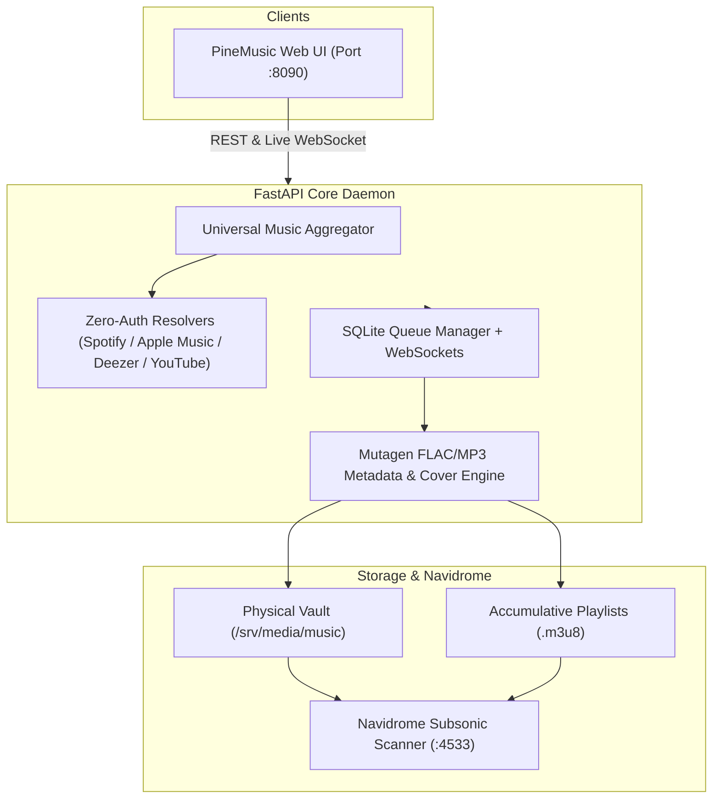

# PineMusic

```
+-----------------------------------------------------------------------------------------+
|                                    PINEMUSIC APPLIANCE                                  |
+-----------------------------------------------------------------------------------------+
|                                                                                         |
|  [ Web Client / Mobile UI ]                                                            |
|          │                                                                              |
|          ▼ (Port :8090 / Reverse Proxy: /pinemusic/*)                                   |
|   ┌─────────────────────────────────────────────────────────────────────────────────┐   |
|   │ FastAPI Core Daemon                                                             │   |
|   │ ├─ Zero-Auth Resolvers: Spotify, Apple Music, Deezer Hi-Fi, YouTube/YT-DLP      │   |
|   │ ├─ Queue Manager: Async SQLite (`aiosqlite`) + Real-time WebSockets             │   |
|   │ ├─ Bitstream Engine: Multi-threaded FLAC-24/16 & MP3-320 Downloader             │   |
|   │ └─ Mutagen Tagger: Embedded hi-res covers, Vorbis comments, ID3v2 tags          │   |
|   └────────────────────────────────────────┬────────────────────────────────────────┘   |
|                                            │                                            |
|                                            ▼                                            |
|   ┌─────────────────────────────────────────────────────────────────────────────────┐   |
|   │ Local Storage Vault (/srv/media/music)                                          │   |
|   │ ├─ Hierarchical Library: `<Artist>/<Album>/<Track> - <Title>.<ext>`             │   |
|   │ └─ Accumulative Playlists: `/srv/media/music/Playlists/<Name>.m3u8`             │   |
|   └────────────────────────────────────────┬────────────────────────────────────────┘   |
|                                            │                                            |
|                                            ▼                                            |
|   ┌─────────────────────────────────────────────────────────────────────────────────┐   |
|   │ Navidrome Music Server                                                          │   |
|   │ └─ Automated Rescan Trigger via Subsonic API (`/rest/startScan.view`)           │   |
|   └─────────────────────────────────────────────────────────────────────────────────┘   |
+-----------------------------------------------------------------------------------------+
```



PineMusic is a high-fidelity, zero-auth music requester, download queue orchestrator, and automated library manager for **Navidrome**. Designed for homelabs and personal cloud audio servers, PineMusic combines the request-tracking lifecycle of **Ombi** with an obsidian matte audio interface.

---

## Key Capabilities

- **Zero-Auth Universal Bitstream Ingest**:
  - **Spotify**: Resolves playlists, albums, and tracks via public embed extraction without requiring user accounts or Spotify Developer API keys.
  - **Apple Music**: Resolves collections, albums, and song links via the official Apple iTunes Lookup API and metadata scraping.
  - **Deezer Hi-Fi**: Direct track, album, and playlist resolution with full ISRC and catalog metadata.
  - **YouTube Music / YouTube**: Automatic single-video and playlist resolution via YT-DLP with mobile player client extractor args to bypass bot challenge gates.
- **Selectable Bitstream Fidelity**:
  - `24-bit / 48kHz Studio Master FLAC` (Maximum fidelity)
  - `16-bit / 44.1kHz Hi-Fi FLAC` (Lossless CD quality)
  - `320 kbps High-Bitrate MP3` (Universal compatibility)
  - `1080p Music Video MP4`
- **Interactive Live Queue**:
  - Real-time download progress, active bitrates, transfer speed, and ETA meters broadcasted via WebSockets (`/api/v1/queue/ws`).
  - Interactive reordering (Move Up / Move Down).
  - Cancel active downloads and 1-click retry for failed items with automated search fallback.
- **Ombi-Style Request Tracking ("Request Only")**:
  - Supports both immediate downloads ("Add to Active Queue") and deferred wishlists ("Request Only").
  - Catalog albums and tracks in the **Requests** tab with status tracking (`PENDING` / `APPROVED`) to avoid bandwidth or storage bottlenecks.
- **Physical Filesystem Vault Scanner & Device Management**:
  - Deep-scans `/srv/media/music` to automatically surface pre-existing tracks in the **Device Library**.
  - Single-click physical file deletion with confirmation that removes the file from disk and triggers a Navidrome scan.
- **Deep Navidrome Integration**:
  - Automatically compiles `.m3u8` playlists in `/srv/media/music/Playlists/`.
  - Automatically triggers Navidrome's Subsonic library scan (`/rest/startScan.view`) upon queue completion.
- **Floating 30-Second Audio Previews**:
  - Built-in lightweight audio preview player for sampling tracks before enqueueing.

---

## Interface Overview

The interface is organized into 4 focused tabs:
1. **Discover**: Search by artist/album/track across all sources or paste public links (Spotify, Apple Music, Deezer, YouTube).
2. **Queue**: Real-time progress, speed, ETA, and priority reordering for all active and pending downloads.
3. **Requests**: Track requested albums, status, and request timestamps.
4. **Device Library**: Browse physical music storage, inspect audio quality, and delete files with live storage telemetry.

---

## Architecture & Technology Stack

- **Backend**: Python 3.12, FastAPI, Uvicorn, Async SQLite (`aiosqlite`), Mutagen, YT-DLP, Requests, WebSockets.
- **Frontend**: React 18, Vite 5, TypeScript, Tailwind CSS, Lucide icons, Framer Motion.
- **Systemd Service**: Runs under `pinemusic.service` bound to port `:8090`.
- **Ingress**: Reverse-proxied via Caddy under `/pinemusic/*`.

---

## Configuration & Environment Variables

PineMusic reads configuration from environment variables or sensible homelab defaults:

| Variable | Default | Purpose |
| :--- | :--- | :--- |
| `PINEMUSIC_PORT` | `8090` | Daemon HTTP port |
| `PINEMUSIC_DIR` | `/srv/media/music` | Root storage directory for physical audio files |
| `PINEMUSIC_PLAYLIST_DIR` | `/srv/media/music/Playlists` | Directory where `.m3u8` playlists are stored |
| `NAVIDROME_URL` | `http://127.0.0.1:4533` | Navidrome Subsonic API endpoint |
| `NAVIDROME_USER` | `pineapple` | Navidrome Subsonic username for rescan notifications |
| `NAVIDROME_PASS` | `pine@2507` | Navidrome Subsonic password for rescan notifications |
| `PINEMUSIC_DB` | `~/.local/share/pinemusic/pinemusic.db` | SQLite database path |

---

## Installation & Deployment

### Quick Setup

```bash
# Clone the repository
git clone https://github.com/imyash0722/pinemusic.git
cd pinemusic

# Set up Python virtual environment
python3 -m venv venv
source venv/bin/activate
pip install -r backend/requirements.txt

# Build the frontend
cd frontend
npm install
npm run build
cd ..

# Run the daemon
python3 backend/run.py
```

### Systemd Service Setup

```ini
[Unit]
Description=PineMusic Appliance - High-Fidelity Music Requester & Ingest Daemon
After=network.target navidrome.service

[Service]
Type=simple
User=pineapple
Group=media
WorkingDirectory=/opt/pinemusic
ExecStart=/opt/pinemusic/venv/bin/python3 backend/run.py
Restart=always
RestartSec=5
Environment=PINEMUSIC_PORT=8090
Environment=PINEMUSIC_DIR=/srv/media/music

[Install]
WantedBy=multi-user.target
```

---

## License

MIT License. Designed and maintained by Yashwanth Karthik (@imyash0722).
